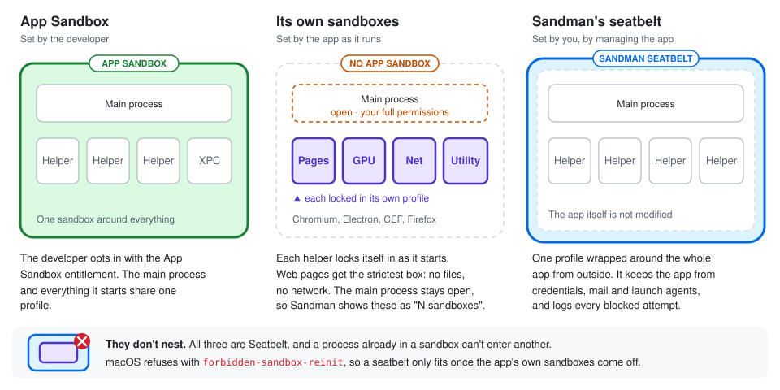

# Sandman

A Mac app that shows which installed applications run without Apple's
[App Sandbox](https://developer.apple.com/documentation/security/app-sandbox),
ranks them by how exposed they are, and lets you put a seatbelt on the ones
you choose.

An app without a sandbox can read and change anything you can. Sandman shows
which apps those are, which of them face the outside world or take orders
from agents, and limits what a compromised one could do.

## Run it

macOS 14+ and Xcode 15+.

    ./build.sh run        # build and open
    ./build.sh install    # put it in /Applications

## Reading the list

The list opens on apps with no sandbox, riskiest first. The tiles switch
between No sandbox, Managed, Sandboxed and All; the ⚡ toolbar toggle narrows
everything to apps running right now.

  

Double-click a row for the details sidebar.

## Managed Applications

Managing an app writes a seatbelt profile for it and a launcher in
`~/Applications/Managed Applications`. Started that way, it can't touch your
credentials, mail and messages, login items or launch agents, and every
blocked attempt is logged. The app itself isn't modified.
[More →](docs/managed-applications.md)

## Layered sandboxes

"No sandbox" describes the main process only. Chromium, Firefox and Electron
apps lock each helper into its own sandbox, and sandboxes don't nest.
Electron apps whose windows run unsandboxed get a red ⚠ and rank higher.

  

[More →](docs/layered-sandboxes.md)

## Deep dives

- [Managed Applications](docs/managed-applications.md): what's blocked, the options, Replace App, running unprotected
- [Layered sandboxes](docs/layered-sandboxes.md): helper sandboxes, the live check, managing a browser
- [Exposure](docs/exposure.md): how apps are rated
- [Logging](docs/logging.md): what's recorded and where
- [Privacy prompts](docs/privacy-prompts.md): why macOS may name Sandman
- [How it works](docs/how-it-works.md): and what it doesn't catch

Themes: View › Theme (Standard, Retro, OS 9, Copland, Things 3, Ink).
