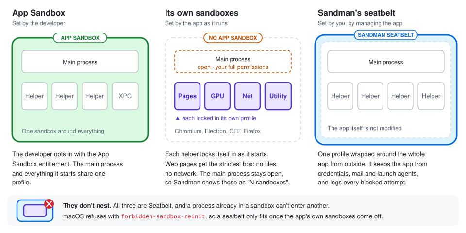
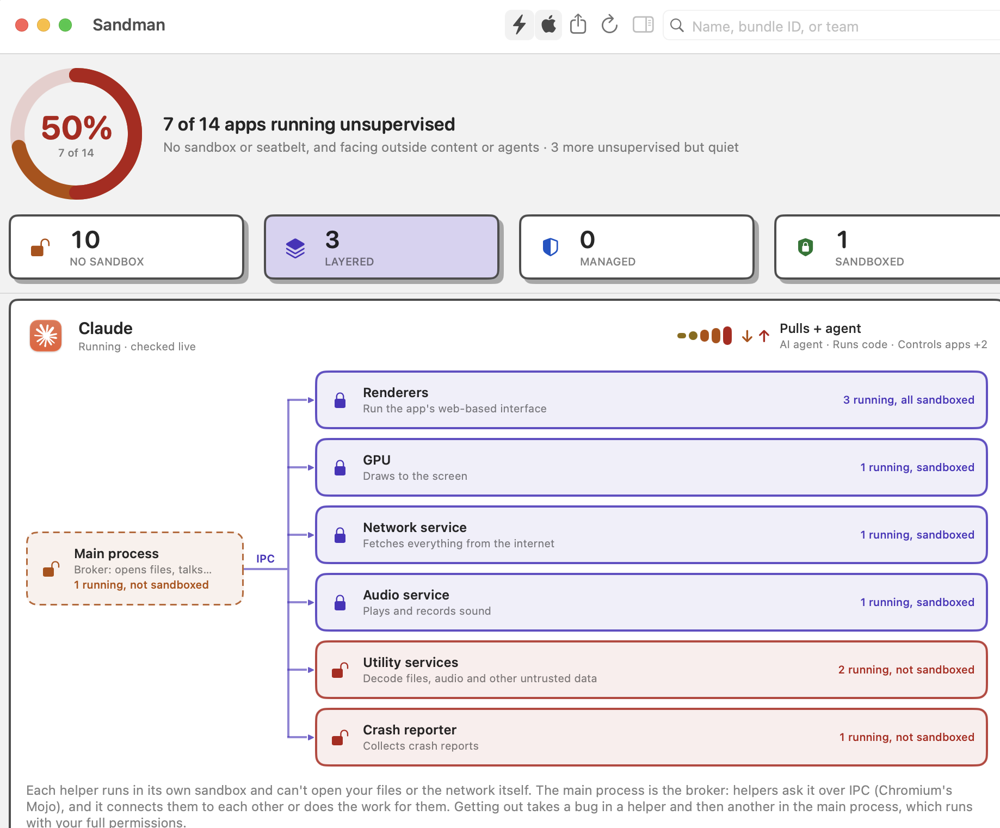

# Layered sandboxes

"Sandboxed" or "No sandbox" is a statement about one process: the app's main
executable. Many apps are really several processes, and the sandboxes can sit
in layers.

  

All three are built on the same macOS mechanism (Seatbelt), and it doesn't
nest: a process that is already in a sandbox can't enter another one. macOS
refuses with `forbidden-sandbox-reinit`, which shows up in a managed app's
Activity log.

## Apps that sandbox themselves

Chromium and everything built on it (Chrome, Edge, Brave, Arc, Vivaldi, Opera,
Electron and CEF apps) and Firefox split into many processes and lock each
helper into its own profile as it starts:

- Renderers / web content: run web pages and their JavaScript. The strictest
  profile: no files, no network, no other apps.
- GPU: draws to the screen.
- Network service: fetches everything from the internet.
- Utility, storage, audio and media services: decode untrusted data.
- Plugins, where the app still has them.

A hostile page has to escape the renderer, then find a second bug in a more
trusted process, before it reaches your files. The weak spot is the main
process, which has no App Sandbox and runs with your full permissions. That is
why Sandman lists these apps among the unsandboxed ones, but doesn't treat
them as wide open.

Electron apps (Slack, Obsidian, Claude, VS Code and many more) are less
certain. An Electron app is Chromium plus Node.js, and it has two halves:

- **Its windows** are web pages, drawn by renderer processes. These can be
  sandboxed like a browser tab. Since Electron 20 (2022) they are by default,
  but a developer can switch it off, and apps built on an older Electron had
  them unsandboxed unless the developer switched it on.
- **Its own code** runs in the main process under Node.js, with no sandbox and
  your full permissions, whatever the windows do.

So "4 sandboxes" on an Electron app is only true if its developer kept the
renderer sandbox on. Sandman checks, and flags the ones that didn't (below).

## What Sandman shows

- Click the **Layered** tile for a card per app that draws its sandboxes: the
  main process (the broker, open) on the left, an IPC line to each sandboxed
  helper on the right, with live counts when the app is running.
  Red means a helper that should be sandboxed and isn't. The crash reporter is
  grey: Chromium never sandboxes it, on purpose, because it has to read other
  processes to write a crash report.

  

- The Sandbox column draws these apps as a fanned stack of indigo cards with
  the number of sandboxed process kinds it found, for example "4 sandboxes"
  for Chrome, and the layers underneath (Pages · GPU · Network · Plugins ·
  main open).
- The details sidebar has a Sandbox layers panel. While the app is running it
  asks the kernel about every process inside the bundle, groups them by role
  (from Chromium's `--type=` and `--utility-sub-type=` arguments, or Firefox's
  process type) and shows how many of each are sandboxed. When the app isn't
  running it reads the helpers from the bundle instead.
- The panel warns when renderers or web content run unsandboxed. That means
  the app was started with `--no-sandbox`, or its developer turned sandboxing
  off.
- Chromium and Electron apps whose renderers aren't actually sandboxed get a
  red warning triangle on their stack, a red second line, and rank higher in
  the list. Sandman catches them two ways:
  - Live: the app is running and at least one renderer has no sandbox
    ("Renderers unsandboxed").
  - From the bundle: it's built on Electron older than 20, when renderers
    were unsandboxed by default ("Electron 13.6.9: renderers open"). Start the
    app to confirm.

  An Electron app that turns the sandbox off in its own code is only caught
  live, while it runs.
- Other apps that ship sandboxed XPC services or helpers (Sparkle's
  downloader, for example) show "N sandboxed helpers" and get the panel too.

## Managing a layered app

Because sandboxes don't nest, a seatbelt can only go on one of these apps if
its own sandboxes come off. Sandman detects them, warns in the Manage sheet,
and won't manage one until you tick "Turn off its own sandbox". It then starts
Chromium-based apps with `--no-sandbox` and Firefox with its sandbox
environment variables switched off.

  

For a web browser this is a bad trade and not recommended: the browser's own
sandbox contains a hostile page far better than one seatbelt around the whole
app. For an Electron app whose renderers turn out to be unsandboxed anyway,
the seatbelt can be the better of the two; check the Sandbox layers panel
first.

---
[← Back to the README](../README.md)
